<!-- banner animado: assets/banner.svg, gerado por assets/banner.py -->
<a href="https://m4ichel.github.io">
  
</a>

<p align="center">
  <a href="https://m4ichel.github.io"></a>
  <a href="https://www.linkedin.com/in/lucas-m4ichel-pereira"></a>
  <a href="mailto:lucas.m4ichel.pereira@gmail.com"></a>
  <a href="https://instagram.com/m4ichel_"></a>
</p>

### `CH.02` whoami

```
lucas@inteli:~$ whoami
lucas michel pereira · ciência da computação @ inteli · 2025 — 2028

lucas@inteli:~$ cat objetivo.txt
buscando oportunidade em data science ou engenharia de software.
gosto de problemas que misturam dados, matemática e engenharia,
do modelo matemático até a API e a infraestrutura.

lucas@inteli:~$ cat fora_do_codigo.txt
videogames · cozinhar · olimpíadas (ouro no canguru, prata na obf)
```

### `CH.03` stack


<sub>+ pandas · numpy · xgboost · shap · or-tools · simplex · branch & bound · teoria dos grafos</sub>

### `CH.04` projetos <sub>· 4 destaques de 8</sub>

| | projeto | parceiro | stack |
|:-:|---|---|---|
| `2026` | Otimização de limites de crédito | Banco PAN | Python · FastAPI · OR-Tools |
| `2026` | Plataforma de telemetria de frontend | Globoplay | TypeScript · AWS · Terraform |
| `2026` | Otimização de recursos contra incêndios | Suzano | Java · Spring Boot · grafos |
| `2025` | Manutenção preditiva de caminhões | Fadel | Python · XGBoost · SHAP |

<sub>▸ cada projeto tem uma simulação interativa em <a href="https://m4ichel.github.io/#projetos">m4ichel.github.io</a></sub>

<p align="right"><sub><i>"Change is often unnoticeable until it's undeniable"</i><br>obrigado ao meu buddy do Inteli, <a href="https://github.com/gui23g">gui23g</a> · <code>CH.06 // EOF</code></sub></p>
